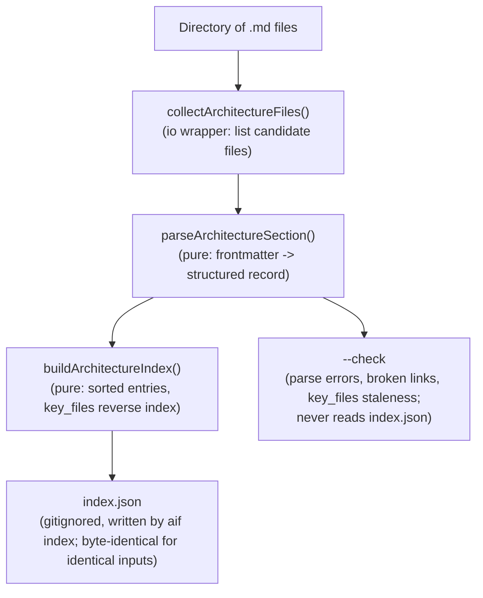

> How `aif index architecture` turns a directory of arc42 Markdown files into a deterministic, on-demand `index.json`, and how `--check` validates the same sources.

## Overview Diagram

`buildArchitectureIndexForDir()` runs the collect → parse → build steps end to end; `lib/commands/index.js` writes the result to `index.json` or, under `--check`, validates the parsed sources directly.

## Motivation

The index is generated on demand and is not committed (`docs/architecture/index.json` is gitignored): nothing generated lives on `main`, so parallel branches cannot conflict on it. Generation is deterministic (entries sorted by path, no timestamp, no per-entry staleness), and `--check` never reads a stored index.

## Contained Building Blocks

| Aspect                          | `architecture.js` (arc42 sections)                                                                                                                                                                                   |
| ------------------------------- | -------------------------------------------------------------------------------------------------------------------------------------------------------------------------------------------------------------------- |
| Source format                   | arc42 frontmatter (`section`/`title`/`lifecycle`/`tags`/`key_files`/`last_verified`) + a one-line `>` blockquote summary                                                                                             |
| Identity                        | The file's `path`, relative to `paths.architecture` — arc42 sections have no separate ID scheme                                                                                                                      |
| File discovery                  | Recursive; `_`-prefixed files (e.g. `_template.md`) excluded                                                                                                                                                         |
| Inverted relationship           | `key_files` → `reverse_index` (`source path → [doc paths]`), via `buildReverseIndex()`                                                                                                                               |
| Extra validation beyond parsing | `isStaleAgainstGit()`: `git log <last_verified>..HEAD -- <key_file>` per `key_file`, plus an unconditional stale if a `key_file` is missing from disk right now (see its own doc comment for why order matters here) |
| Sort key                        | `path`                                                                                                                                                                                                               |

It parses its frontmatter via `parseFrontmatter()` (`lib/file-utils.js` — see §5.02's Consumers section for the other consumers of that same generic-utility module).

## Important Interfaces

| Block             | Pure functions                                                                                            | io wrappers                                                                                                                                                |
| ----------------- | --------------------------------------------------------------------------------------------------------- | ---------------------------------------------------------------------------------------------------------------------------------------------------------- |
| `architecture.js` | `parseArchitectureSection()`, `buildReverseIndex()`, `buildArchitectureIndex()`, `extractRelativeLinks()` | `collectArchitectureFiles()`, `loadArchitectureRecords()`, `isStaleAgainstGit()`, `findStaleDocs()`, `findBrokenLinks()`, `buildArchitectureIndexForDir()` |

`isStaleAgainstGit()` is the one piece of the module that touches git beyond reading the target directory, so it is kept out of `buildArchitectureIndex()` entirely — the assembly step stays pure and testable against synthetic fixtures with no real repo, per `steering/engineering/core.md`'s testability rule, and `findStaleDocs()` computes staleness separately for `--check`.

## Consumers

`lib/commands/index.js` is the sole caller of `architecture.js`'s `loadArchitectureRecords()`, `buildArchitectureIndex()`, `findStaleDocs()`, and `findBrokenLinks()` — arc42 sections' own cross-references are relative markdown links between flat sibling files, so only `architecture.js` scans for broken ones. `aif index architecture` and its `--check` mode are the only entry points into the module. Nothing else in this repo imports `architecture.js` directly.

## Waiver Parsing (`arch-waivers.js`)

`lib/arch-waivers.js` (AIF-013) parses `Arch-Unaffected: <section> — <reason>`
commit waivers, used by the PR-range staleness gate. Pure: `parseWaivers()` (matches
the line anywhere in a message, including bullet-prefixed squash bodies; em dash or
spaced ASCII `--`/`-` separator), `validateReason()` (at least 10 non-space characters,
not a placeholder), `evaluateWaivers()` (section-level coverage: one accepted waiver
covers every changed file its section lists; unknown or non-listing sections are
rejected), `escapeTableCell()` (markdown/HTML-safe output). io: `readCommits()` runs
`git log` via `execFileSync` with an argument array, rejecting refs starting with `-`.
