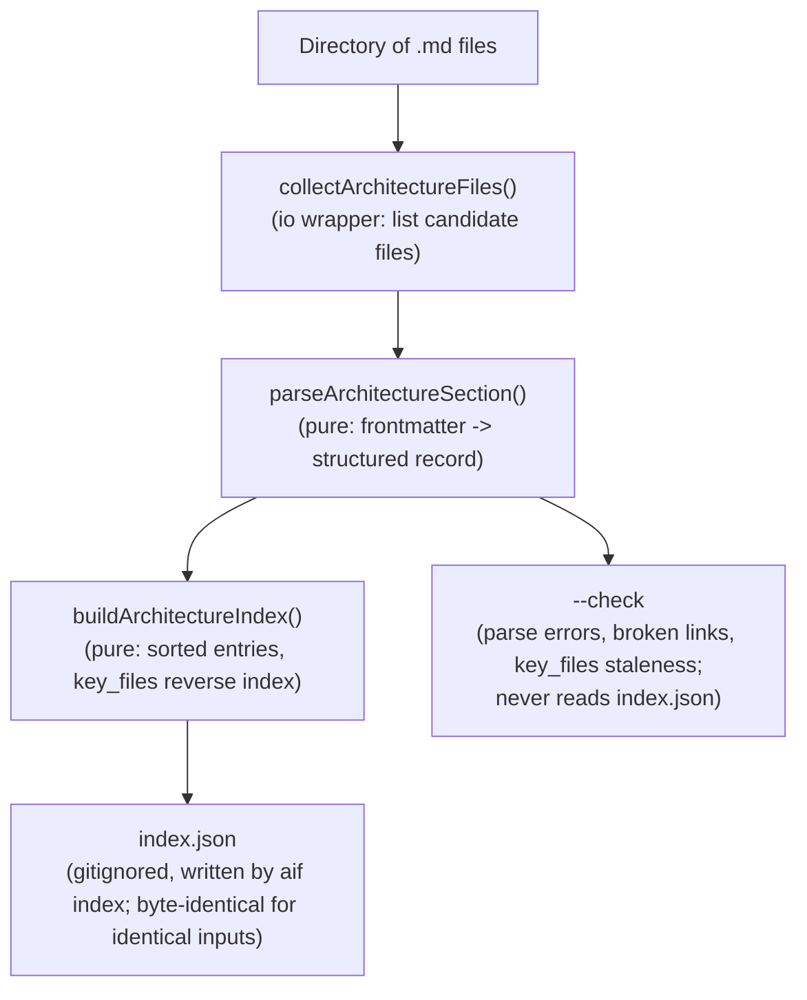

> How `aif index architecture` turns a directory of arc42 Markdown files into a deterministic, on-demand `index.json`, and how `--check` validates the same sources.

## Overview Diagram

`buildArchitectureIndexForDir()` runs the collect → parse → build steps end to end; `lib/commands/index.js` writes the result to `index.json` or, under `--check`, validates the parsed sources directly.

## Motivation

The index is generated on demand and is not committed (`docs/architecture/index.json` is gitignored): nothing generated lives on `main`, so parallel branches cannot conflict on it. Generation is deterministic (entries sorted by path, no timestamp, no per-entry staleness), and `--check` never reads a stored index.

The index is kept fresh without anyone running it by hand: `.githooks/` (`post-merge`, `post-checkout`, `post-rewrite` → `refresh-index`) regenerate it after a pull, branch switch or rebase, never failing the git operation. A `commit-msg` hook runs `aif index architecture --commit-msg`, which warns (never fails) when the staged files touch a section's `key_files` with neither the doc nor an `Arch-Unaffected` line in the commit, via the pure `findUnwaivedSections()` (`lib/arch-waivers.js`); it is advisory because the doc may be updated in a later commit, and is skipped for merge commits. `npm install` (`prepare`) points `core.hooksPath` at `.githooks`, and the cloud `scripts/session-start.sh` does the same and builds the index once, since a fresh clone has no hooks yet.

## Contained Building Blocks

| Aspect                          | `architecture.js` (arc42 sections)                                                                                                                                                                                                                                                                                                                                                                                                                                                                                                                                                                                                                                                                                                                                                                                                                                                                                    |
| ------------------------------- | --------------------------------------------------------------------------------------------------------------------------------------------------------------------------------------------------------------------------------------------------------------------------------------------------------------------------------------------------------------------------------------------------------------------------------------------------------------------------------------------------------------------------------------------------------------------------------------------------------------------------------------------------------------------------------------------------------------------------------------------------------------------------------------------------------------------------------------------------------------------------------------------------------------------- |
| Source format                   | arc42 frontmatter (`section`/`title`/`lifecycle`/`tags`/`key_files`) + a one-line `>` blockquote summary                                                                                                                                                                                                                                                                                                                                                                                                                                                                                                                                                                                                                                                                                                                                                                                                              |
| Identity                        | The file's `path`, relative to `paths.architecture` — arc42 sections have no separate ID scheme                                                                                                                                                                                                                                                                                                                                                                                                                                                                                                                                                                                                                                                                                                                                                                                                                       |
| File discovery                  | Recursive; `_`-prefixed files (e.g. `_template.md`) excluded                                                                                                                                                                                                                                                                                                                                                                                                                                                                                                                                                                                                                                                                                                                                                                                                                                                          |
| Inverted relationship           | `key_files` → `reverse_index` (`source path → [doc paths]`), via `buildReverseIndex()`                                                                                                                                                                                                                                                                                                                                                                                                                                                                                                                                                                                                                                                                                                                                                                                                                                |
| Extra validation beyond parsing | `isStaleAgainstGit()`: `git log --no-merges HEAD --not <every non-merge commit that edited the doc> -- <key_file>` per `key_file`, so a key_file change counts only if no doc-editing commit has it in its history and merge commits never count; a commit in that result is ignored if its message carries `Arch-Unaffected: <section> — <reason>` for this doc (`lib/arch-waivers.js`, pure), or if it is an ancestor of a later unchecked commit that does (`uncoveredCommits()` over `git rev-list <waiver commit> --not <doc commits> -- <key_file>`), so a missed waiver is fixed with a new commit and never covers commits made after it, or is authored by a bot account (`<name>[bot]`, e.g. `dependabot[bot]`), since an automated update cannot add the trailer. Plus an unconditional stale if a `key_file` is missing from disk right now. A doc with no commit yet or uncommitted edits is never stale |
| Sort key                        | `path`                                                                                                                                                                                                                                                                                                                                                                                                                                                                                                                                                                                                                                                                                                                                                                                                                                                                                                                |

It parses its frontmatter via `parseFrontmatter()` (`lib/file-utils.js` — see §5.02's Consumers section for the other consumers of that same generic-utility module).

## Important Interfaces

| Block             | Pure functions                                                                                                                                                                           | io wrappers                                                                                                                                                |
| ----------------- | ---------------------------------------------------------------------------------------------------------------------------------------------------------------------------------------- | ---------------------------------------------------------------------------------------------------------------------------------------------------------- |
| `architecture.js` | `parseArchitectureSection()`, `buildReverseIndex()`, `buildArchitectureIndex()`, `extractRelativeLinks()`, `isBotAuthor()`, `parseCommits()`, `commitMakesStale()`, `uncoveredCommits()` | `collectArchitectureFiles()`, `loadArchitectureRecords()`, `isStaleAgainstGit()`, `findStaleDocs()`, `findBrokenLinks()`, `buildArchitectureIndexForDir()` |

`isStaleAgainstGit()` is the one piece of the module that touches git beyond reading the target directory, so it is kept out of `buildArchitectureIndex()` entirely — the assembly step stays pure and testable against synthetic fixtures with no real repo, per `steering/engineering/core.md`'s testability rule, and `findStaleDocs()` computes staleness separately for `--check`.

## Consumers

`lib/commands/index.js` is the sole caller of `architecture.js`'s `loadArchitectureRecords()`, `buildArchitectureIndex()`, `findStaleDocs()`, and `findBrokenLinks()` — arc42 sections' own cross-references are relative markdown links between flat sibling files, so only `architecture.js` scans for broken ones. `aif index architecture` and its `--check` mode are the only entry points into the module. Nothing else in this repo imports `architecture.js` directly.
