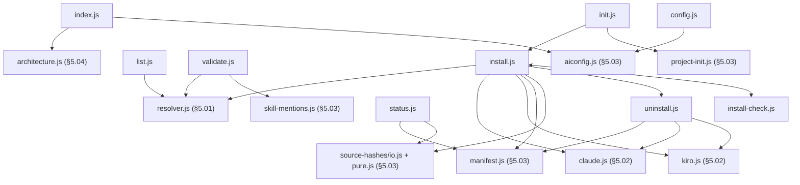

> One file per `aif <verb>` subcommand — what each one actually resolves, reads,
> or writes, and which Core libraries/Harness adapters it calls straight into.

## Overview Diagram

## Motivation

Nine files sharing one uniform shape (parse this command's own args, call straight
into whichever Core library/Harness adapter does the real work, return) — genuinely
one cohesive whitebox, not six unrelated responsibilities the way §5.03 is. The
split from `05_building_blocks.md` isn't because any single command is complex
enough to need its own diagram (none is); it's the same `key_files`-list-length
reasoning §5.03 already gives for its own existence: nine files' individual
freshness needs somewhere to be tracked without bloating the Level-1 doc's own
list past what keeps a rename or deletion there a meaningful signal.

## Contained Building Blocks

| Block              | Responsibility                                                                                                                                                                                                                                                                                                                                                                                                                                                                                                                                                                                                                                                                                      | Interface                                                 |
| ------------------ | --------------------------------------------------------------------------------------------------------------------------------------------------------------------------------------------------------------------------------------------------------------------------------------------------------------------------------------------------------------------------------------------------------------------------------------------------------------------------------------------------------------------------------------------------------------------------------------------------------------------------------------------------------------------------------------------------- | --------------------------------------------------------- |
| `install.js`       | Resolves a bundle via `resolver.js`, writes its components through the target harness adapter (an unknown agent tool name fails the install, exit 1), records the result in the manifest. On reinstall it removes what the bundle's previous install wrote and the new one does not (retired agents, skills, rules; servers and hooks nothing else uses), so upgrades leave no leftovers. `--scope global\|project` picks the target (§5.02 "Install scope"); project scope always reinstalls rather than trusting source hashes, since its output is committed. `--skip-project` drops bundles the project's own manifest already lists, so SessionStart's global install does not duplicate them. | `runInstall(parsed, repoRoot, projectRoot)`               |
| `install-check.js` | `aif install --scope project --check`: reinstalls each harness's recorded bundles into a temporary project and compares files byte for byte with the committed ones, reporting changed, missing and retired paths. MCP settings files are compared by aif's own server entries only, since a project may add its own. Catches adapter changes that source hashes miss. Always exits 0; under GitHub Actions it also emits a warning annotation, which CI runs as a non-failing step.                                                                                                                                                                                                                | `runCheck(repoRoot, projectRoot)`, `diffInstall()`        |
| `uninstall.js`     | Removes previously-installed files, at the given `--scope`, using the manifest's recorded file list, except files another bundle's entry also lists (e.g. standards); per-harness settings cleanup (e.g. MCP entries).                                                                                                                                                                                                                                                                                                                                                                                                                                                                              | `runUninstall(parsed, repoRoot, projectRoot)`             |
| `status.js`        | Reports what's installed vs. current source state (staleness), for the global manifest or, with `--scope project`, each harness's project manifest.                                                                                                                                                                                                                                                                                                                                                                                                                                                                                                                                                 | `runStatus(parsed, repoRoot, projectRoot)`                |
| `list.js`          | Lists available bundles/agents/skills/servers in this repo. No `standards` target.                                                                                                                                                                                                                                                                                                                                                                                                                                                                                                                                                                                                                  | `runList(parsed, repoRoot)`                               |
| `validate.js`      | Schema (including agent `tools`/`approved_tools` names: a `TOOLS` name or `@server/tool` reference), cross-reference, and bundle-resolution integrity checks (`aif validate`), including that a bundle's steering files exist. `schema` also rejects a malformed `requires_skills` field. A fourth target, `skill-deps` (part of the default run), checks `requires_skills` entries exist and that `skill/<name>` mentions in skill and steering files are declared, using `resolver.js`'s closure and `skill-mentions.js` (§5.03); other mentions are warnings that do not fail the run.                                                                                                           | `runValidate(parsed, repoRoot)`                           |
| `index.js`         | Generates the architecture index (`aif index architecture`) on demand, deterministically; `--check` validates the source docs without reading any stored index.                                                                                                                                                                                                                                                                                                                                                                                                                                                                                                                                     | `runIndex(parsed, repoRoot)`, `resolveArchitecturePath()` |
| `init.js`          | Scaffolds a new project from `projects/_template/`, interactively or via flags. The template includes the git hooks and session-start script that keep the gitignored architecture index fresh; executable bits are preserved on copy. `--with-default-bundles` then installs every `default: true` bundle for Claude Code at project scope.                                                                                                                                                                                                                                                                                                                                                        | `runInit(parsed, repoRoot)`, `promptForConfig()`          |
| `config.js`        | Resolves a single `.aiconfig.json` field to its configured value or documented default (`aif config <key>`).                                                                                                                                                                                                                                                                                                                                                                                                                                                                                                                                                                                        |

## Consumers

`bin/aif.js` is the sole caller of every command in this table — it parses argv
and dispatches to exactly one `run*()` handler per invocation (§5 Entry points).
`install.js` and `status.js` both compute source hashes through
`source-hashes/io.js` (§5.03) for freshness checking; no command owns that logic.
