> One file per `aif <verb>` subcommand — what each one actually resolves, reads,
> or writes, and which Core libraries/Harness adapters it calls straight into.

## Overview Diagram

```mermaid
graph TD
  Install["install.js"]
  Uninstall["uninstall.js"]
  Status["status.js"]
  List["list.js"]
  Validate["validate.js"]
  Test["test.js"]
  Snapshot["snapshot.js"]
  Index["index.js"]
  Init["init.js"]
  Config["config.js"]
  Oversight["oversight.js"]

  Resolver["resolver.js (§5.01)"]
  SkillMentions["skill-mentions.js (§5.03)"]
  Manifest["manifest.js (§5.03)"]
  SnapLib["snapshot/io.js + pure.js (§5.03)"]
  Architecture["architecture.js (§5.04)"]
  AiConfig["aiconfig.js (§5.03)"]
  OversightLib["oversight.js (§5.03)"]
  ProjInit["project-init.js (§5.03)"]
  Claude["claude.js (§5.02)"]
  Kiro["kiro.js (§5.02)"]

  Install --> Resolver & Claude & Kiro & Manifest & SnapLib
  Uninstall --> Manifest & Claude & Kiro
  Status --> Manifest & SnapLib
  List --> Resolver
  Validate --> Resolver & SkillMentions
  Snapshot --> SnapLib
  Index --> Architecture & AiConfig
  Init --> ProjInit
  Config --> AiConfig
  Oversight --> AiConfig & OversightLib
```

`test.js` has no edge — it only shells out to this repo's own `node:test` runner
(`execSync`), no library dependency.

## Motivation

Eleven files sharing one uniform shape (parse this command's own args, call straight
into whichever Core library/Harness adapter does the real work, return) — genuinely
one cohesive whitebox, not six unrelated responsibilities the way §5.03 is. The
split from `05_building_blocks.md` isn't because any single command is complex
enough to need its own diagram (none is); it's the same `key_files`-list-length
reasoning §5.03 already gives for its own existence: eleven files' individual
freshness needs somewhere to be tracked without bloating the Level-1 doc's own
list past what keeps a rename or deletion there a meaningful signal.

## Contained Building Blocks

| Block          | Responsibility                                                                                                                                                                                                                                                                                                                                                                                                                                                                                                                                                                            | Interface                                                 |
| -------------- | ----------------------------------------------------------------------------------------------------------------------------------------------------------------------------------------------------------------------------------------------------------------------------------------------------------------------------------------------------------------------------------------------------------------------------------------------------------------------------------------------------------------------------------------------------------------------------------------- | --------------------------------------------------------- |
| `install.js`   | Resolves a bundle via `resolver.js`, writes its components through the target harness adapter (an unknown agent tool name fails the install, exit 1), records the result in the manifest.                                                                                                                                                                                                                                                                                                                                                                                                 | `runInstall(parsed, repoRoot)`                            |
| `uninstall.js` | Removes previously-installed files using the manifest's recorded file list; per-harness settings cleanup (e.g. MCP entries).                                                                                                                                                                                                                                                                                                                                                                                                                                                              | `runUninstall(parsed, repoRoot)`                          |
| `status.js`    | Reports what's installed vs. current source state (staleness) for a project.                                                                                                                                                                                                                                                                                                                                                                                                                                                                                                              | `runStatus(parsed, repoRoot)`                             |
| `list.js`      | Lists available bundles/agents/skills/servers in this repo. No `standards` target.                                                                                                                                                                                                                                                                                                                                                                                                                                                                                                        | `runList(parsed, repoRoot)`                               |
| `validate.js`  | Schema (including agent `tools`/`approved_tools` names: a `TOOLS` name or `@server/tool` reference), cross-reference, and bundle-resolution integrity checks (`aif validate`), including that a bundle's steering files exist. `schema` also rejects a malformed `requires_skills` field. A fourth target, `skill-deps` (part of the default run), checks `requires_skills` entries exist and that `skill/<name>` mentions in skill and steering files are declared, using `resolver.js`'s closure and `skill-mentions.js` (§5.03); other mentions are warnings that do not fail the run. | `runValidate(parsed, repoRoot)`                           |
| `test.js`      | Thin wrapper invoking this repo's own `node:test` suite.                                                                                                                                                                                                                                                                                                                                                                                                                                                                                                                                  | `runTest(parsed, repoRoot)`                               |
| `snapshot.js`  | Builds/reads per-bundle, per-server, and per-hook source-hash snapshots.                                                                                                                                                                                                                                                                                                                                                                                                                                                                                                                  | `runSnapshot(parsed, repoRoot)`                           |
| `index.js`     | Generates the architecture index (`aif index architecture`) on demand, deterministically; `--check` validates the source docs without reading any stored index.                                                                                                                                                                                                                                                                                                                                                                                                                           | `runIndex(parsed, repoRoot)`, `resolveArchitecturePath()` |
| `init.js`      | Scaffolds a new project from `projects/_template/`, interactively or via flags. The template includes the git hooks and session-start script that keep the gitignored architecture index fresh; executable bits are preserved on copy.                                                                                                                                                                                                                                                                                                                                                    | `runInit(parsed, repoRoot)`, `promptForConfig()`          |
| `config.js`    | Resolves a single `.aiconfig.json` field to its configured value or documented default (`aif config <key>`).                                                                                                                                                                                                                                                                                                                                                                                                                                                                              |
| `oversight.js` | Prints the effective oversight level (`aif oversight [--request <level>]`): the configured `oversight.default`, with a prompt-requested level applied unless `oversight.enforced` forbids lowering it. A bare `--request` with no value is a usage error; a request ignored because of enforcement is reported on stderr.                                                                                                                                                                                                                                                                 | `runOversight(parsed, cwd)`                               |     | `runConfig(parsed, cwd)` |

## Consumers

`bin/aif.js` is the sole caller of every command in this table — it parses argv
and dispatches to exactly one `run*()` handler per invocation (§5 Entry points).
`install.js` also calls back into its own `snapshot.js` (`readSnapshot`,
`readServerSnapshot`, `readHookSnapshot`) and `status.js` does the same, since
freshness-checking at install/status time reuses the same reader `snapshot.js`
itself uses to build those snapshots in the first place.
