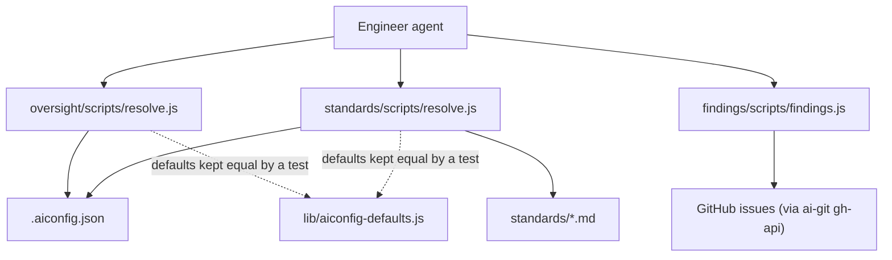

> Deterministic procedures that ship inside a skill folder, so an agent runs them instead of re-deriving the logic.

## Overview Diagram

## Motivation

Skills install as whole folders into the harness's skills directory, away from this repo's `node_modules`, with no executable bit. A script that ships in a skill must therefore be a plain `node scripts/x.js` with **zero dependencies**, so it cannot import from `lib/`. The cost is that a few defaults exist twice (`oversight.default`, `oversight.enforced`, `project_standards`); unit tests assert they equal `lib/aiconfig-defaults.js`.

## Contained Building Blocks

| Script                                | Responsibility                                                                                                                                                                                                   | Interface                                                       |
| ------------------------------------- | ---------------------------------------------------------------------------------------------------------------------------------------------------------------------------------------------------------------- | --------------------------------------------------------------- |
| `skills/oversight/scripts/resolve.js` | Resolves the effective oversight level from `.aiconfig.json` and an optional requested level; an enforced setting only lets a request raise the level. Fails closed on an invalid value.                         | `resolveOversight()`, CLI `--request`, `--config`               |
| `skills/standards/scripts/resolve.js` | Tag-matches `standards/*.md` against the project's `standards` tags, adds the `depends_on` closure dependencies-first, and appends the optional project override last when it exists.                            | `resolveStandards()`, `projectOverridePath()`, CLI `--json`     |
| `skills/findings/scripts/findings.js` | Builds a path → findings map from open GitHub issues labelled `finding`, looks it up by path, and files a finding by commenting on a matching one or opening a new issue. The only script with a network effect. | `buildMap()`, `lookup()`, `planFiling()`, CLI `[paths]`, `file` |

The decision logic in each script is pure and unit-tested; only `main()` and a few thin helpers touch the filesystem or `ai-git gh-api`.

## Consumers

The `engineer` agent runs them through `skill/oversight`, `skill/standards` and `skill/findings`. Findings makes GitHub Issues a runtime data store for agents, unlike the CLI, which has no runtime GitHub dependency (§3).
