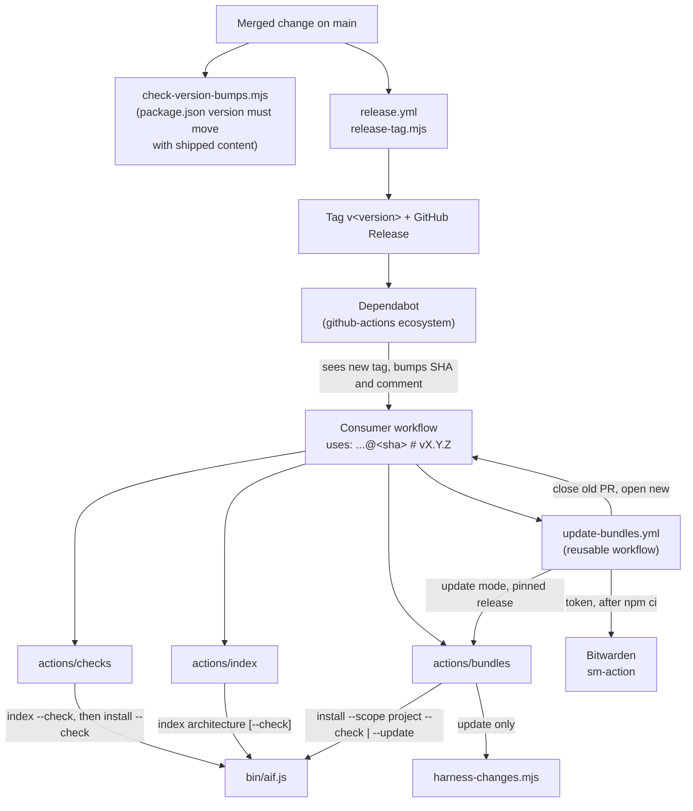

> The reusable composite GitHub Actions and the reusable update workflow that let a consumer repository run `aif` in CI, and the release workflow that gives them versions to pin.

## Overview Diagram



## Motivation

A consumer repository (first: Folio) must validate its arc42 docs and keep its committed install current without copying shell steps. A composite action is the smallest unit that does this, and it ships with the `ai-foundation` repository itself, so a consumer needs nothing else installed.

Consumers pin an action by full commit SHA with the release version in a trailing comment. Dependabot's `github-actions` ecosystem reads that comment, so it needs a tag per release; `release.yml` creates one for every merged change. That works only if the version moves with each change, so `check-version-bumps.mjs` also requires `package.json`'s version to rise when shipped content changes.

## Contained Building Blocks

| Block                                    | Responsibility                                                                                                                                                                                                                                                                                                                                                                                                                                                                                                                                                                                                                            | Interface                                                                                                                                                                                              |
| ---------------------------------------- | ----------------------------------------------------------------------------------------------------------------------------------------------------------------------------------------------------------------------------------------------------------------------------------------------------------------------------------------------------------------------------------------------------------------------------------------------------------------------------------------------------------------------------------------------------------------------------------------------------------------------------------------- | ------------------------------------------------------------------------------------------------------------------------------------------------------------------------------------------------------ |
| `.github/actions/index/action.yml`       | Composite action. Validates `mode`, runs `npm ci --omit=dev` at the `ai-foundation` root (three levels above the action), then `node <root>/bin/aif.js index architecture` with `--check` for `check`. Runs in the caller's working directory.                                                                                                                                                                                                                                                                                                                                                                                            | Input `mode`: `check` (default) or `generate`; any other value fails.                                                                                                                                  |
| `.github/actions/bundles/action.yml`     | Composite action, same install step. `check` runs `install --scope project --check` (always exit 0; drift is a warning annotation). `update` runs `install --scope project --update`, which refreshes only bundles already in the project manifest and never installs new ones, then runs `harness-changes.mjs`. There is no bundle list.                                                                                                                                                                                                                                                                                                 | Input `mode`: `check` (default) or `update`. Output `changed`: `true` or `false`.                                                                                                                      |
| `.github/actions/checks/action.yml`      | Composite action with no inputs: one `npm ci --omit=dev`, then `index architecture --check`, then `install --scope project --check` (which runs even when the index check failed, so one run reports both). Equivalent to the `index` and `bundles` actions in `check` mode.                                                                                                                                                                                                                                                                                                                                                              | None. Fails when the index check fails; drift stays a warning.                                                                                                                                         |
| `.github/scripts/harness-changes.mjs`    | Sets `changed` from `git status --porcelain` limited to the project harness directories (`PROJECT_HARNESS_DIRS` in `lib/scope.js`), untracked files included. aif's own "N updated" count cannot be used: `isCurrent()` is always false at project scope, so every run reports "1 updated" even when nothing changed.                                                                                                                                                                                                                                                                                                                     | `hasChanges()` (pure), `run()`; writes `changed=` to `GITHUB_OUTPUT`.                                                                                                                                  |
| `.github/workflows/update-bundles.yml`   | Reusable workflow (`workflow_call`) for the daily update: runs the `bundles` action in `update` mode, fetches the token from Bitwarden Secrets Manager afterwards, then closes the open `aif/update-bundles` PR (the repository's own, not a fork's) and its branch and opens a fresh PR from the default branch when `changed` is true. One run at a time (`concurrency`, no cancel); the git auth header is masked. The `bundles` action is referenced by repository and pinned to a release, because a local `./` path would resolve in the caller.                                                                                    | Inputs `token-secret-id` (required), `cloud-region`, `node-version`. Secret `BWS_ACCESS_TOKEN`.                                                                                                        |
| `.github/workflows/release.yml`          | On a push to `main`, runs `release-tag.mjs`; when it says release, creates tag `v<version>` and a GitHub Release at the pushed commit with the preinstalled `gh`. Top-level permissions are none; `contents: write` is on this one job. It runs after the merge, so it neither changes nor waits on the required checks. Runs are serialised.                                                                                                                                                                                                                                                                                             | Trigger: push to `main`.                                                                                                                                                                               |
| `.github/scripts/release-tag.mjs`        | Decides whether `package.json`'s version needs a release: only when tag `v<version>` does not exist, which makes a re-run or a version-neutral commit a no-op. A version that is not plain semver is refused, so the tag that reaches the shell is safe.                                                                                                                                                                                                                                                                                                                                                                                  | `decideRelease()` (pure), `run()`; writes `release=` and `tag=`.                                                                                                                                       |
| `.github/scripts/version-bump-logic.mjs` | Pure rules for `check-version-bumps.mjs`: version ordering, and `package.json`'s version must rise when a change touches `agents/`, `skills/`, `steering/`, `standards/`, `servers/`, `bundles/`, `projects/`, `bin/` or `lib/`. `package.json` and `package-lock.json` anywhere do not count, so Dependabot PRs stay exempt. It also picks which open branch a PR was forked from: the most recent merge-base wins, and `main` wins a tie, so an unrelated open PR that contains the same `main` tip is never taken as the parent.                                                                                                       | `isOlder()`, `needsPackageBump()`, `packageBumpError()`, `pickParentRef()`, `readVersion()`                                                                                                            |
| `.github/scripts/merge-logic.mjs`        | Pure decisions for the `/merge` bot (`docs/plans/merge-bot.md`): the comment is exactly `/merge`; the commenter is a human with write access and not the AI identity; the PR passes the gate (open, non-draft, same-repo, targets `main`, mergeable, not Dependabot, one `bump:*` label when shipped content changes, no hand-edited version, the required checks known and every one green on the head); the version to assign (`main`'s plus the label, `major` below 1.0 bumping the minor); that the bot's version commit changes only the version fields; and the mapping of API payloads to the gate input and the dry-run comment. | `parseCommand()`, `decideAuthorization()`, `evaluateGate()`, `decideMerge()`, `nextVersion()`, `applyVersion()`, `verifyVersionOnly()`, `toGateInput()`, `requiredChecksFromRules()`, `renderDryRun()` |
| `.github/scripts/merge.mjs`              | Thin I/O wrapper around `merge-logic.mjs`: authorizes the commenter, reads the PR, its files, check runs, the branch's required checks and the `package.json` versions over the GitHub REST API, and posts the result as a PR comment. Dry run only: it writes nothing but that comment and refuses to run unless `DRY_RUN=true` or with no `AI_LOGINS`. It never runs PR code.                                                                                                                                                                                                                                                           | `run()` (injectable `api`), `createApi()`, `paginate()`                                                                                                                                                |
| `.github/workflows/merge.yml`            | On a `/merge` comment on a PR, runs `merge.mjs` from the default branch's checkout (never the PR's) with read access and PR-comment permission only. Event data reaches the script through environment variables. Runs are serialised and none is cancelled. Needs the repository variable `AI_LOGINS`. The live merge, the GitHub App and the ruleset bypass are not built yet.                                                                                                                                                                                                                                                          | Trigger: `issue_comment` created.                                                                                                                                                                      |
| `.github/workflows/windows-actions.yml`  | Manual only (`workflow_dispatch`). Runs the `index`, `bundles` (check) and `checks` actions from the checkout on `windows-latest`, to verify Git Bash path handling on demand. Not a required check; `bundles` `update` and the reusable update workflow are not exercised.                                                                                                                                                                                                                                                                                                                                                               | Trigger: manual dispatch.                                                                                                                                                                              |

The actions hold no secrets and use no network beyond `npm ci --omit=dev` for `ai-foundation`'s own dependencies. Every `run:` step sets `shell: bash` so they work on Windows runners; `tests/validation/github-actions.test.js` enforces that, and that no step uses a third-party action. `tests/validation/update-bundles-workflow.test.js` checks the reusable workflow: callable, token as explicit input and secret, read-only permissions, every action pinned to a SHA with a release comment, no local action path.

## Important Interfaces

Caller prerequisites, documented in each action's README: the caller checks out its own repository (`index` needs `fetch-depth: 0`, since staleness is computed from git history) and installs Node 22.23.4 or newer before using the action.

## Consumers

Pin by full commit SHA and name the release in a comment, so Dependabot can bump both:

```yaml
steps:
  - uses: actions/checkout@<sha> # vX.Y.Z
    with:
      fetch-depth: 0
  - uses: actions/setup-node@<sha> # vX.Y.Z
    with:
      node-version: 22.23.4
  - uses: starvoxel/ai-foundation/.github/actions/index@<sha> # vX.Y.Z
  - id: bundles
    uses: starvoxel/ai-foundation/.github/actions/bundles@<sha> # vX.Y.Z
    with:
      mode: update
  - if: steps.bundles.outputs.changed == 'true'
    run: echo "committing the refreshed install is the caller's job"
```

To run both checks with one line, use `checks` in place of `index` and `bundles` (`check`):

```yaml
- uses: starvoxel/ai-foundation/.github/actions/checks@<sha> # vX.Y.Z
```

To keep the install current, call the reusable workflow from a scheduled workflow. The caller passes the Bitwarden secret's ID as an input and the access token as a secret, so nothing depends on whether a called workflow sees the caller's variables:

```yaml
on:
  schedule:
    - cron: '47 5 * * *'
  workflow_dispatch:

permissions:
  contents: read

jobs:
  update:
    uses: starvoxel/ai-foundation/.github/workflows/update-bundles.yml@<sha> # vX.Y.Z
    with:
      token-secret-id: ${{ vars.AIF_UPDATE_TOKEN_SECRET_ID }}
    secrets:
      BWS_ACCESS_TOKEN: ${{ secrets.BWS_ACCESS_TOKEN }}
```

Add the `github-actions` ecosystem to the consumer's `.github/dependabot.yml` so new releases arrive as PRs. `bundles` `update` only changes the working tree; committing or opening a PR from the `changed` output is the caller's job.
