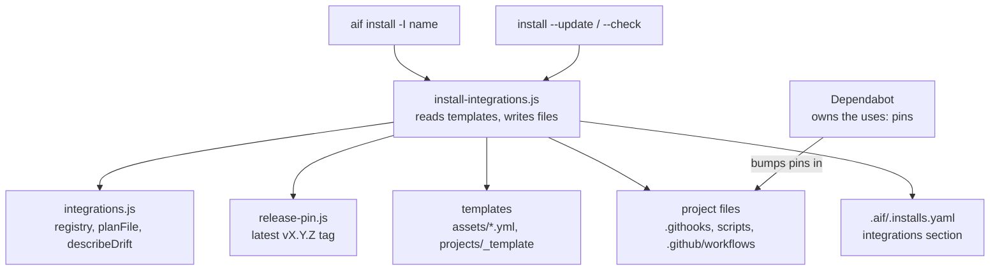

> The files every project that uses ai-foundation wants, installed with `aif install -I <name>` and kept current without a hand-copied script.

## Overview Diagram

## Motivation

Folio set up the same integrations by hand: the index and drift checks in CI, a daily bundle-update workflow, git hooks, and a session-start script. Every project would repeat that and drift from AIF. An integration is not a bundle: it is harness-agnostic, it lives in `.github/`, `.githooks/` and `scripts/` rather than a harness directory, and part of it (the `uses:` pins in the workflows) belongs to Dependabot, not to AIF.

## Contained Building Blocks

| Block                                         | Responsibility                                                                                                                                                                                                                                                                                                                                                          | Interface                                                                                       |
| --------------------------------------------- | ----------------------------------------------------------------------------------------------------------------------------------------------------------------------------------------------------------------------------------------------------------------------------------------------------------------------------------------------------------------------- | ----------------------------------------------------------------------------------------------- |
| `lib/integrations.js`                         | Pure. The registry (`checks`, `update`, `hooks`, `session-start`: target, template source, executable, pinned), name expansion (`all`), pin normalisation and rendering, `planFile()` (write, current, adopt or skip a file) and `describeDrift()` (missing, modified locally, update available), and `refreshedPaths()` (what a bare `--update` may rewrite).          | `INTEGRATIONS`, `expandIntegrationNames()`, `planFile()`, `describeDrift()`, `refreshedPaths()` |
| `lib/release-pin.js`                          | Pure. Picks the highest plain `vX.Y.Z` tag, and validates an explicit `--pin`/`--pin-version`. A file cannot hold the SHA of the commit that releases it, so the pin is the latest release visible in the ai-foundation checkout.                                                                                                                                       | `pickLatestTag()`, `explicitPin()`                                                              |
| `lib/commands/install-integrations.js`        | The I/O: reads templates and project files, runs git in the checkout to resolve the pin, writes files (executable bit where set), records them in `.aif/.installs.yaml`, prints one line per file, and prints the snippets for files the project owns. `installIntegrations()` for `-I`; `updateIntegrations()` and `checkIntegrations()` for `--update` and `--check`. | `installIntegrations()`, `updateIntegrations()`, `checkIntegrations()`, `resolvePin()`          |
| `lib/integrations/assets/aif-*.yml`           | Templates of the two workflows. `{{AIF_SHA}}` and `{{AIF_VERSION}}` appear only on the pin line, so a pin alone never counts as a change (a test enforces it). `aif-checks.yml` calls the `checks` action; `aif-update.yml` calls the reusable `update-bundles.yml` workflow (§5.07).                                                                                   | Rendered by `renderAsset()`                                                                     |
| `projects/_template/.githooks`, `.../scripts` | The hooks and the session-start script, shared with `aif init`: the integrations install the template's own files rather than a second copy. `commit-msg` warns, never blocks, when a commit touches a `key_files` entry with neither its doc nor an `Arch-Unaffected` waiver.                                                                                          | Copied to `.githooks/` and `scripts/`                                                           |

## Important Interfaces

**What a run does with a file.** For each file the installer compares three things with pins ignored: what is on disk, what the template renders, and the hash recorded at the last install.

| On disk                                         | Result                                                                                                       |
| ----------------------------------------------- | ------------------------------------------------------------------------------------------------------------ |
| absent                                          | written                                                                                                      |
| equals the template                             | left alone; recorded if it was not (`adopt`)                                                                 |
| equals the recorded hash, template has moved on | rewritten with a fresh pin (`template updated`)                                                              |
| anything else                                   | left alone and reported (`modified locally`, or `exists and was not installed by aif`); `--force` overwrites |

A second run therefore changes nothing, and a Dependabot bump to a pin is not an edit.

**`--update` and `--check`.** A bare `aif install --update` refreshes only the files with no pins (hooks, session script) when they are unedited. Workflow files are never rewritten by it, because their pins are Dependabot's and pushing changes under `.github/workflows/` needs a token permission the daily update does not hold; it reports "newer template" and names `aif install -I <name>`. `--check` reports missing, modified-locally and update-available files as a warning, never a failure, and lists shipped integrations the project has not installed.

**Files the project owns.** `dependabot.yml`, `ci.yml` and `.claude/settings.json` are never edited. The installer prints the snippet to add instead.

**Scope.** Project scope only. `-I` with `--scope global` is an error; `-I` with `--update` or `--check` is an error. `aif init` installs all four; without a release tag in the checkout it installs the two that need no pin and says how to add the workflows.

**The pin.** The latest `vX.Y.Z` tag in the ai-foundation checkout and the commit it points to, or `--pin <sha> --pin-version <vX.Y.Z>`. With neither (no tags, not a git checkout) installing a workflow fails with that instruction and writes nothing.

## Consumers

`aif install -I all` in a project; `aif install --update` (refreshes the unpinned files) and `aif install --check` in CI through the `bundles` and `checks` actions (§5.07). The daily update commits exactly `refreshedPaths()` and the harness directories.
