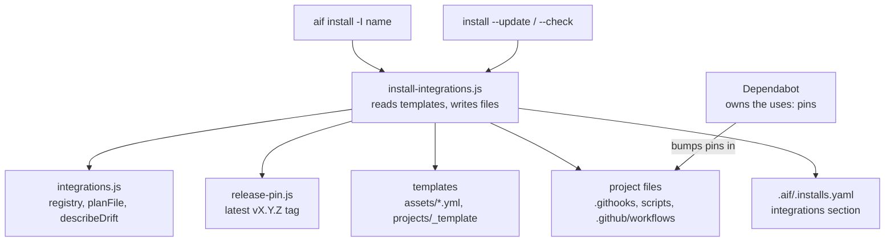

> The files every project that uses ai-foundation wants, installed with `aif install -I <name>` and kept current without a hand-copied script.

## Overview Diagram

## Motivation

Folio set up the same integrations by hand: the index and drift checks in CI, a daily bundle-update workflow, git hooks, and a session-start script. Every project would repeat that and drift from AIF. An integration is not a bundle: it is harness-agnostic, it lives in `.github/`, `.githooks/` and `scripts/` rather than a harness directory, and part of it (the `uses:` pins in the workflows) belongs to Dependabot, not to AIF.

## Contained Building Blocks

| Block                                         | Responsibility                                                                                                                                                                                                                                                                                                                                                                                                                                                                                                                                            | Interface                                                                                       |
| --------------------------------------------- | --------------------------------------------------------------------------------------------------------------------------------------------------------------------------------------------------------------------------------------------------------------------------------------------------------------------------------------------------------------------------------------------------------------------------------------------------------------------------------------------------------------------------------------------------------- | ----------------------------------------------------------------------------------------------- |
| `lib/integrations.js`                         | Pure. The registry (`checks`, `update`, `merge`, `hooks`, `session-start`: target, template source, executable, pinned), name expansion (`all`), pin normalisation and rendering, `planFile()` (write, current, adopt or skip a file) and `describeDrift()` (missing, modified locally, update available), and `refreshedPaths()` (what a bare `--update` may rewrite).                                                                                                                                                                                   | `INTEGRATIONS`, `expandIntegrationNames()`, `planFile()`, `describeDrift()`, `refreshedPaths()` |
| `lib/release-pin.js`                          | Pure. Picks the highest plain `vX.Y.Z` tag, and validates an explicit `--pin`/`--pin-version`. A file cannot hold the SHA of the commit that releases it, so the pin is the latest release visible in the ai-foundation checkout.                                                                                                                                                                                                                                                                                                                         | `pickLatestTag()`, `explicitPin()`                                                              |
| `lib/commands/install-integrations.js`        | The I/O: reads templates and project files, runs git in the checkout to resolve the pin, writes files (executable bit where set), records them in `.aif/.installs.yaml`, prints one line per file, and prints the snippets for files the project owns. `installIntegrations()` for `-I`; `updateIntegrations()` and `checkIntegrations()` for `--update` and `--check`.                                                                                                                                                                                   | `installIntegrations()`, `updateIntegrations()`, `checkIntegrations()`, `resolvePin()`          |
| `lib/integrations/assets/aif-*.yml`           | Templates of the three workflows. `{{AIF_SHA}}` and `{{AIF_VERSION}}` appear only on the pin line, so a pin alone never counts as a change (a test enforces it). `aif-checks.yml` calls the `checks` action; `aif-update.yml` calls the reusable `update-bundles.yml` workflow (§5.07); `aif-merge.yml` holds the `/merge` bot's triggers, permissions and concurrency and calls the `merge` action (§5.07), a dry run until the repository variable `MERGE_BOT_LIVE` is `true`, with `workflows: [CI]` and `version-paths` left for the project to edit. | Rendered by `renderAsset()`                                                                     |
| `projects/_template/.githooks`, `.../scripts` | The hooks and the session-start script, shared with `aif init`: the integrations install the template's own files rather than a second copy. `commit-msg` warns, never blocks, when a commit touches a `key_files` entry with neither its doc nor an `Arch-Unaffected` waiver.                                                                                                                                                                                                                                                                            | Copied to `.githooks/` and `scripts/`                                                           |

## Important Interfaces

**What a run does with a file.** For each file the installer compares three things with pins ignored: what is on disk, what the template renders, and the hash recorded at the last install.

| On disk                                         | Result                                                                                                       |
| ----------------------------------------------- | ------------------------------------------------------------------------------------------------------------ |
| absent                                          | written                                                                                                      |
| equals the template                             | left alone; recorded if it was not (`adopt`)                                                                 |
| equals the recorded hash, template has moved on | rewritten, keeping the pins already in the file (`template updated`)                                         |
| anything else                                   | left alone and reported (`modified locally`, or `exists and was not installed by aif`); `--force` overwrites |

A second run therefore changes nothing, and a Dependabot bump to a pin is not an edit.

**Safety.** A target whose path crosses a symlink is refused (`✗ ... is a symlink; refused`, exit 1), even with `--force`, so a hostile repository cannot point `.githooks` or `.github` somewhere else and have a write follow it. Files are written with LF and compared with CRLF normalised, so a Windows checkout and a Linux one record the same hash. A rewrite keeps the pins already in the file, because Dependabot may have moved them past the release this checkout knows, and advances one that is older than the release in hand, because the new template may need it. `aif install -I` gives a file that matches the template but lost its executable bit that bit back, adding execute only where the file is already readable; the daily `--update` does not, so a hook someone disabled with `chmod -x` stays disabled, and a file the project owns is never given one. The pin comes only from the ai-foundation checkout's own git repository: a copy without a `.git` of its own would read the tags of whatever repository contains it, so it is refused with the `--pin` instruction. The manifest is guarded the same way as the targets: `.aif` or `.aif/.installs.yaml` as a symlink is refused before it is read or written. An unreadable `.aif/.installs.yaml` stops `-I` and `--update` with a message (`--check` warns); entries it cannot use are ignored, and entries for names this aif does not know are kept, since they may come from a newer aif.

**`--update` and `--check`.** A bare `aif install --update` refreshes only the files with no pins (hooks, session script) when they are unedited. Workflow files are never rewritten by it, because their pins are Dependabot's and pushing changes under `.github/workflows/` needs a token permission the daily update does not hold; it reports "newer template" and names `aif install -I <name>`. A file recorded as installed but deleted is reported, never brought back; `aif install -I <name>` restores it. The recorded version moves only when every file of the integration is on the new template. `--check` reports missing, modified-locally, symlinked and update-available files as a warning, never a failure, and lists shipped integrations the project has not installed.

**Files the project owns.** `dependabot.yml`, `ci.yml` and `.claude/settings.json` are never edited. The installer prints the snippet to add instead.

**Scope.** Project scope only. With `-B` in the same command the integrations are written first; if the bundle half then fails the exit code is non-zero and the integration files stay. `-I` with `--scope global` is an error; `-I` with `--update` or `--check` is an error. `aif init` installs every integration; without a release tag in the checkout it installs the two that need no pin and says how to add the workflows.

**The pin.** The latest `vX.Y.Z` tag in the ai-foundation checkout and the commit it points to, or `--pin <sha> --pin-version <vX.Y.Z>` (`aif init` accepts the same flags). With neither (no tags, not a git checkout) installing a workflow fails with that instruction and writes nothing.

## Consumers

`aif install -I all` in a project; `aif install --update` (refreshes the unpinned files) and `aif install --check` in CI through the `bundles` and `checks` actions (§5.07). The daily update commits exactly `refreshedPaths()` and the harness directories.
